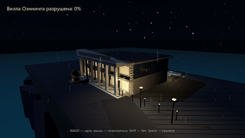

# 🏛️ Симулятор Демонтажа Виллы Альфреда Оеннинга

Интерактивный 3D-проект по мотивам кадров фильма «Я, робот» (2004): ночь, дождь, звёзды и луна,
вилла на скале над морем. Игрок ходит по дому и террасе, затем к плазе подъезжает машина
с героем-детективом, робот NS-5 начинает демонтаж — и дом обрушивается этаж за этажом.

Текущая версия — **Godot 4.7.2 (GDScript)**. Старый Unity-код оставлен в репозитории как история.



*Анимация сноса: удар гидромолота, волна обрушения и осыпавшиеся обломки (`godot/build/preview/collapse.gif`).*

## 🚀 Быстрый старт (локально, Windows)

Готовая сборка:

```powershell
godot\build\VillaOenninger.exe
```

Открыть и редактировать в редакторе — File → Import → `godot\project.godot`.

## 🎮 Управление

| Клавиша | Действие |
|---|---|
| `W A S D` | ходьба |
| мышь | обзор |
| `Space` | прыжок |
| `Shift` | бег |
| `E` | взять кошку / начать демонтаж |
| `Esc` | освободить курсор |

Сценарии: дойти до террасы → дождаться машины с героем → `E`. Если успеть взять кошку
до начала обрушения, она спасена; процент разрушения виллы показан в HUD.

## 📂 Структура

```
godot/
  project.godot          конфиг проекта (gl_compatibility, 1440x810)
  scenes/main.tscn       единственная сцена, корень VillaGame
  scripts/
    game.gd              состояния INTRO → WALK → ARRIVAL → COLLAPSE, свет и окружение
    villa_builder.gd     генератор виллы, скалы, моря, машины, робота, кошки
    collapse_director.gd волны обрушения, пыль, тряска камеры
    collapse_part.gd     поведение отдельной рушащейся части
    player.gd            контроллер от первого лица
    car_arrival.gd       приезд героя
    robot_wrecker.gd     робот-сносчик
    cat_critter.gd       кошка
    hud.gd               интро с тремя законами, тосты, прогресс
  tests/smoke.gd         headless-проверка логики
  tests/shots.gd         рендер контрольных кадров в build/shots/
  build/VillaOenninger.exe
```

Вся сцена строится кодом во время выполнения — редактор Godot для правок не обязателен.

## 🧪 Проверки

```powershell
$gd = "D:\MultiTool-build\tools\godot\Godot_v4.7.2-stable_win64_console.exe"
& $gd --headless --path godot --script res://tests/smoke.gd
& $gd --path godot --script res://tests/shots.gd
```

`smoke.gd` проверяет сборку виллы, игрока, машину, робота, кошку и прохождение обрушения
(`ACTIVE=68/68`). `shots.gd` пишет семь кадров в `godot\build\shots\`: `01-approach`
(ночной подъезд), `02-terrace` (терраса и бассейн), `03-interior` (интерьер), `04-robot`
(робот NS-5), `05-hero` (герой у машины), `06-collapse` (обрушение в процессе),
`07-aftermath` (после обрушения).

Важно: `shots.gd` нужно запускать **без** `--headless` — в headless-режиме
`get_viewport().get_texture()` возвращает `null` и `save_png()` падает.

## 📦 Сборка exe

Нужны export-шаблоны Godot 4.7.2 в `%APPDATA%\Godot\export_templates\4.7.2.stable`.

```powershell
& $gd --headless --path godot --export-release "Windows Desktop" godot\build\VillaOenninger.exe
```

## ⚠️ Заметки по движку

- Рендерер — **`gl_compatibility`**: Forward+ падает на AMD Radeon RX Vega 10
  (`scene_shader_forward_clustered.cpp:546`). Glow на этом бэкенде недоступен.
- `dotnet` не требуется: проект полностью на GDScript.

## 🕰️ Unity-версия (архив)

`Assets/`, `ProjectSettings/`, `Packages/`, `VillaOenningerSim.csproj` и `Makefile` — исходный
Unity-проект и сборка WebGL через Codespaces. Код не удалён как история, но текущая игра на нём
не собирается; актуальная реализация — в `godot/`.
